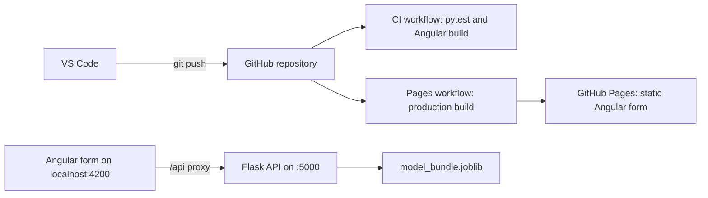
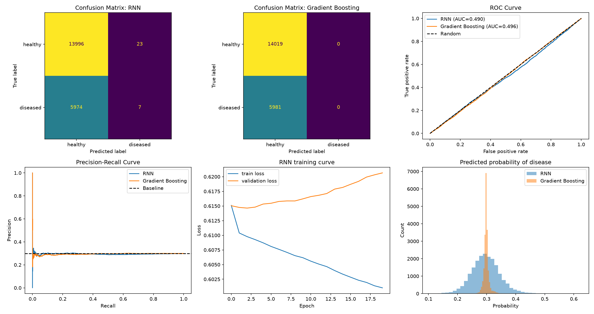

# Health Lifestyle Classification: ML Model to Flask, Angular and GitHub CI/CD

A teaching project that takes a trained machine learning model all the way to a working full-stack application:

- two models compared on a 100,000-record health and lifestyle dataset,
- the better-suited model served through a **Flask** REST API,
- an **Angular** web form with 44 input fields that calls the API,
- source code on **GitHub**, tested and built automatically with **GitHub Actions**,
- the Angular interface published on **GitHub Pages**.

| Resource | Link |
|---|---|
| Repository | https://github.com/bangash044/ml-project |
| Live site (static form) | https://bangash044.github.io/ml-project/ |

> **Important:** this is a research and teaching prototype. It is **not** a medical diagnosis tool. Both models perform at chance level on this dataset (see [Results](#results)).

---

## Table of contents

1. [Architecture](#architecture)
2. [Project structure](#project-structure)
3. [Dataset](#dataset)
4. [Model comparison](#model-comparison)
5. [Results](#results)
6. [Flask API](#flask-api)
7. [Angular frontend](#angular-frontend)
8. [CI/CD with GitHub Actions](#cicd-with-github-actions)
9. [Environment](#environment)
10. [Run it locally](#run-it-locally)
11. [Tests](#tests)
12. [Limitations](#limitations)
13. [Troubleshooting notes](#troubleshooting-notes)

---

## Architecture



- **Locally:** the Angular form sends the 44 values to Flask (`POST /predict`) and shows the predicted class and probabilities.
- **On GitHub Pages:** only the static form is hosted. It cannot run Flask or the model, so the predict button is disabled and a notice explains why.

## Project structure

```text
ml-project/
├── .github/workflows/
│   ├── ci.yml                    # backend tests + Angular build
│   └── pages.yml                 # production build + deploy to GitHub Pages
├── backend/
│   ├── app.py                    # Flask API (/health, /predict)
│   ├── train_export.py           # trains the model and saves the bundle
│   ├── make_payload.py           # builds test_payload.json from the sample row
│   ├── make_schema.py            # generates the Angular form schema from the data
│   ├── test_pipeline.py          # local inference check (no Flask)
│   ├── test_api.py               # HTTP check against a running server
│   ├── test_payload.json         # one complete sample input (44 values)
│   ├── requirements.txt
│   ├── models/model_bundle.joblib
│   └── tests/
│       ├── test_api.py           # pytest API tests
│       └── test_structure.py     # pytest project-structure test
├── data/
│   └── sample_inputs.csv         # one complete sample row
│                                 # (the full CSV is git-ignored, see below)
├── docs/
│   ├── two_model_comparison.csv  # metric table
│   ├── two_model_comparison.png  # comparison figure
│   └── environment.txt           # tool versions
├── frontend/                     # Angular application
│   ├── proxy.conf.json           # forwards /api to Flask during development
│   └── src/app/
│       ├── app.ts, app.html, app.css
│       ├── app.config.ts
│       ├── prediction.service.ts
│       └── feature-schema.ts     # auto-generated, 44 fields
├── notebooks/
│   ├── 00_check_data.py          # shape, target counts, missing values
│   └── model_comparison.py       # RNN vs Gradient Boosting
└── README.md
```

The full dataset (`health_lifestyle_classification.csv`, about 53 MB) is listed in `.gitignore` and is **not** stored in the repository. To reproduce the training, place it in `data/`.

## Dataset

| Property | Value |
|---|---|
| Records | 100,000 |
| Columns | 48 (44 used as model inputs) |
| Target | `target`: `healthy` 70,097 (70.1%) and `diseased` 29,903 (29.9%) |
| Input features | 27 numeric, 17 categorical |

**Columns removed:** `survey_code` (an ID), `electrolyte_level` and `environmental_risk_score` (constant values), and `target` (the label).

**The 44 input features**

| Group | Features |
|---|---|
| Demographics | age, gender, education_level, job_type, occupation, income |
| Body measures | height, weight, bmi, bmi_estimated, bmi_scaled, bmi_corrected, waist_size |
| Clinical values | blood_pressure, heart_rate, cholesterol, glucose, insulin |
| Sleep and activity | sleep_hours, sleep_quality, work_hours, physical_activity, daily_steps, exercise_type, screen_time, device_usage |
| Diet and habits | calorie_intake, sugar_intake, water_intake, meals_per_day, diet_type, caffeine_intake, alcohol_consumption, smoking_level |
| Mental health | stress_level, mental_health_score, mental_health_support |
| Context | healthcare_access, insurance, sunlight_exposure, family_history, pet_owner |
| Other | gene_marker_flag, daily_supplement_dosage |

**Missing values** appear in seven columns:

| Column | Missing |
|---|---|
| insulin | 15,836 |
| heart_rate | 14,003 |
| alcohol_consumption | 13,910 |
| gene_marker_flag | 10,474 |
| income | 8,470 |
| daily_steps | 8,329 |
| blood_pressure | 7,669 |

> **"None" is a real category.** Several columns (for example alcohol, exercise and caffeine) contain the text `None` as a genuine answer. pandas reads that text as a missing value by default, so every `read_csv` in this project uses `keep_default_na=False, na_values=[""]`. Only truly empty cells count as missing.

**Data quality observations:** four BMI columns are near duplicates, and `daily_supplement_dosage` contains negative values. Check data quality before drawing conclusions from this dataset.

## Model comparison

Both models used the same pipeline:

- stratified **80/20 split** (80,000 training and 20,000 test records, `random_state=42`),
- numeric features: median imputation, then MinMax scaling,
- categorical features: constant imputation (`"Missing"`), then one-hot encoding,
- 44 input columns become **84** processed columns.

| | Model 1: RNN | Model 2: Gradient Boosting |
|---|---|---|
| Implementation | Keras `SimpleRNN` | scikit-learn `HistGradientBoostingClassifier` |
| Architecture | SimpleRNN(64) → Dense(32, ReLU) → Dense(1, sigmoid), 11,649 parameters | gradient-boosted decision trees |
| Settings | Adam, learning rate 0.001, 20 epochs, batch size 256, 10% validation split | learning rate 0.08, up to 500 iterations, early stopping |
| Training outcome | validation loss rose while training loss fell | stopped after **12** trees |

The **Gradient Boosting** model is the one that is deployed. It saves together with its preprocessing as one scikit-learn pipeline, which is what the Flask app loads. The RNN stays in the comparison notebook.

## Results

| Metric (test set) | RNN | Gradient Boosting |
|---|---|---|
| Accuracy | 0.7002 | 0.7010 |
| ROC AUC | 0.490 | 0.496 |
| PR AUC | 0.2951 | 0.2951 |
| Diseased cases found (of 5,981) | 7 | 0 |



**Interpretation**

- **Both models perform at chance level.** The ROC curves lie on the diagonal (AUC about 0.5), and PR AUC equals the share of diseased people (about 0.30).
- **The 70% accuracy is not skill.** It only reflects that 70% of records are healthy. Gradient Boosting predicted "healthy" for every record, and the RNN found only 7 of 5,981 diseased cases.
- **The RNN overfits.** Its training loss falls while its validation loss rises.
- **Conclusion:** in this dataset the features do not separate healthy from diseased individuals. Accuracy alone is misleading here, so judge such models by ROC AUC, PR AUC and recall.

Metric table: `docs/two_model_comparison.csv`.

## Flask API

Base URL when run locally: `http://127.0.0.1:5000`

| Endpoint | Method | Purpose |
|---|---|---|
| `/health` | GET | status check |
| `/predict` | POST | returns the predicted class and probabilities |

**Health check**

```json
{"features": 44, "status": "ok", "task": "classification"}
```

**Prediction request:** a JSON object with exactly the 44 feature names as keys (see `backend/test_payload.json` for a complete example).

```powershell
curl.exe --noproxy "*" -i -X POST "http://127.0.0.1:5000/predict" `
  -H "Content-Type: application/json" `
  --data-binary "@backend/test_payload.json"
```

**Prediction response**

```json
{
  "disclaimer": "Research/teaching prototype only.",
  "label": "healthy",
  "prediction": 0,
  "probabilities": [0.7035, 0.2965],
  "task": "classification"
}
```

`probabilities` are ordered `[healthy, diseased]`.

**Error handling:** missing or extra keys and invalid JSON return HTTP 400 with a message that names the problem. Unexpected failures return HTTP 500 without exposing internals.

**Model bundle** (`backend/models/model_bundle.joblib`) contains the fitted preprocessing and model pipeline, the ordered list of 44 feature names, the task type, the class labels and a version string.

## Angular frontend

- **Form:** 44 fields (number inputs and dropdowns). Field names, number ranges and dropdown options are **generated from the real data** by `backend/make_schema.py`, so the form always matches the model input.
- **Validation:** an empty field shows a message such as "Enter a value for Age", and out-of-range numbers are rejected.
- **Result panel:** predicted class, raw prediction, class probabilities and the disclaimer.
- **Errors:** if Flask is not running, the form shows a visible "API error" message.
- **Proxy:** during development `proxy.conf.json` forwards `/api/*` to `http://127.0.0.1:5000`.
- **Static mode:** on any host other than `localhost` (for example GitHub Pages) the form shows a notice and disables the predict button.
- **No Zone.js:** this Angular version creates apps without Zone.js, so `app.config.ts` must not use `provideZoneChangeDetection`, and `app.ts` calls `ChangeDetectorRef.markForCheck()` after the API answers so the result panel updates.

Regenerate the form schema after retraining:

```powershell
python backend\make_schema.py
```

## CI/CD with GitHub Actions

| Workflow | Trigger | What it does |
|---|---|---|
| **Full-stack CI** (`ci.yml`) | push and pull request to `main` | backend job: Python 3.12, install `requirements.txt`, run `pytest`. Frontend job: Node 24, `npm ci`, `npm run build`, upload the build as an artifact |
| **Deploy Angular to GitHub Pages** (`pages.yml`) | push to `main` | production Angular build with `--base-href /ml-project/`, then publishes `frontend/dist/frontend/browser` to GitHub Pages |

Every push to `main` therefore tests the code and updates the live site automatically. This was demonstrated by changing the subtitle on the page from "CI/CD Demo v1" to "CI/CD Demo v2" and watching the live site update after the workflows turned green.

## Environment

| Tool | Version |
|---|---|
| Python | 3.12.6 |
| Node.js | v24.13.1 |
| npm | 11.8.0 |
| Angular CLI | 21.2.27 |
| Git | 2.55.0.windows.3 |
| TensorFlow (notebook only) | 2.21.0 |

Two separate virtual environments are used:

| Environment | Used for | Contains TensorFlow |
|---|---|---|
| `.venv` | Flask API, model export, tests, CI | no |
| `.venv_ml` | RNN vs Gradient Boosting comparison notebook | yes |

The model is trained inside `.venv`, so the scikit-learn version that saves the bundle matches the one in `backend/requirements.txt` and in CI.

## Run it locally

These commands are for Windows PowerShell, run from the project root (`D:\ml_project` in the original setup).

**1. Place the dataset**

Copy `health_lifestyle_classification.csv` into `data/`.

**2. Set up the API environment**

```powershell
py -3.12 -m venv .venv
.\.venv\Scripts\Activate.ps1
python -m pip install -r backend\requirements.txt
```

If script execution is blocked, run `Set-ExecutionPolicy -Scope Process -ExecutionPolicy RemoteSigned` first.

**3. Train and export the model**

```powershell
python backend\train_export.py
python backend\make_payload.py
python backend\test_pipeline.py
```

Expect `Input features: 44` and `PASS: local inference`.

**4. (Optional) Run the model comparison notebook**

```powershell
py -3.12 -m venv .venv_ml
.\.venv_ml\Scripts\Activate.ps1
python -m pip install pandas numpy scikit-learn matplotlib tensorflow ipykernel
python notebooks\00_check_data.py
python notebooks\model_comparison.py
```

Close each plot window when it opens so the script continues. Results are written to `docs/`.

**5. Start the Flask API (Terminal 1)**

```powershell
.\.venv\Scripts\Activate.ps1
python backend\app.py
```

Open http://127.0.0.1:5000/health to check it.

**6. Start the Angular app (Terminal 2)**

```powershell
cd frontend
npm ci
ng serve --open --proxy-config proxy.conf.json
```

Open http://localhost:4200, fill all 44 fields (use the values in `backend/test_payload.json`) and click **Run local prediction**.

## Tests

```powershell
python -m pytest -q backend\tests
```

Five automated tests:

| Test | Checks |
|---|---|
| `test_health` | `/health` returns 200 and reports 44 features |
| `test_predict_valid` | a valid sample returns 200 with a prediction |
| `test_predict_missing_feature` | a missing feature returns 400 |
| `test_predict_invalid_json` | invalid JSON returns 400 |
| `test_source_files_exist` | key project files are present |

The same tests run in CI on every push. A manual end-to-end check (filling the form and getting a result) complements them.

## Limitations

- **Model quality:** both models perform at chance level (ROC AUC about 0.49 to 0.50). The deployed model should not be used for any real decision.
- **Data quality:** some columns are constant or contain implausible values, and the label shows no relationship with the features. The dataset needs review before any real use.
- **Hosting:** GitHub Pages serves only static files. Live predictions work only when Flask and Angular run on the same machine.
- **Scope:** this is a research and teaching prototype and **not** a medical diagnosis tool.

## Troubleshooting notes

Problems met while building this project and how they were solved:

| Problem | Cause and fix |
|---|---|
| `py -3.12` says no suitable Python runtime | only Python 3.14 was installed. Install Python 3.12 (needed for TensorFlow) and tick "Add python.exe to PATH" |
| pip: "packages do not match the hashes" | a download was corrupted on an unstable connection. Use `pip cache purge` and `--no-cache-dir`, install packages one group at a time, or switch networks |
| Text `None` turned into missing values | pandas reads `None` as NaN. Use `keep_default_na=False, na_values=[""]` |
| Blank Angular page, console error `NG0908` (requires Zone.js) | remove `provideZoneChangeDetection` from `app.config.ts` and use `ChangeDetectorRef.markForCheck()` |
| Result panel never updates (no Zone.js) | call `markForCheck()` in the subscribe callbacks |
| `ng serve`: "Port 4200 is already in use" | Angular is already running in another terminal. Use that one |
| `/api/health` through Angular returns 404 | Angular was started without `--proxy-config proxy.conf.json` |
| Dataset and virtual environments staged in Git | the root `.gitignore` was missing. Create it, then `git rm -r --cached .` and `git add .` |
| `nothing to commit` after an edit | the file was not saved in the editor (`Ctrl+S`) |